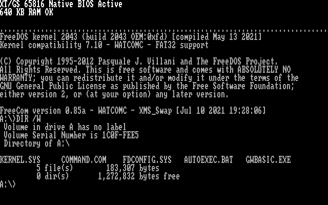
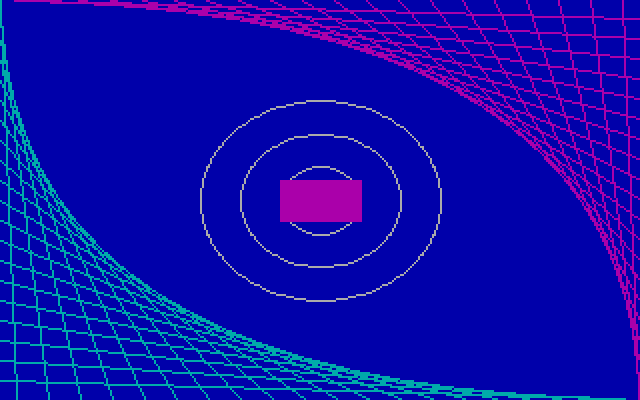
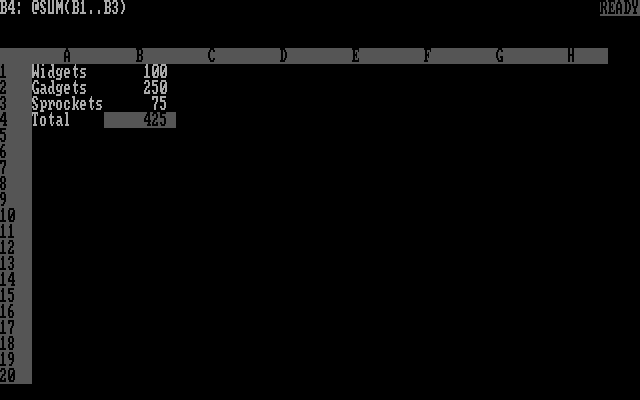

# XT/GS

An IBM PC/XT for the Apple IIGS. XT/GS is an 8086/8088 real-mode interpreter
and a PC-compatible BIOS, written in 65816 assembly (Merlin32) for an 8 MB
Apple IIGS and booted straight from ProDOS 8. It boots FreeDOS from a floppy
image to the `A:\>` prompt and runs real DOS software on top of it: GW-BASIC
with CGA graphics and sound, and Lotus 1-2-3 Release 1A.

| | |
| --- | --- |
|  |  |
| FreeDOS: the XT/GS POST banner, the kernel, FreeCOM and `DIR /W` | GW-BASIC: three lines typed in, `LIST` from F1, `RUN` from F2 |
|  |  |
| GW-BASIC `SCREEN 1` (CGA 320x200, four colours): `LINE`, `CIRCLE`, `COLOR 1,1` | Lotus 1-2-3 1A: labels, values and `@SUM(B1..B3)` |
|  |  |
| 1-2-3's `/Graph` menu | `/Graph View`: the bar graph of that worksheet, drawn by 1-2-3's CGA driver |

The screenshots are the emulated IIGS's Super Hi-Res screen, captured from
headless MAME runs and doubled in height (the SHR screen is 640x200 or
320x200).

## Status

Everything here has been run in MAME's `apple2gs` driver (ROM 03, 8 MB) only.
It has **never been tried on a real IIGS**. It is also slow: a stock 2.8 MHz
IIGS runs the guest at about 15,600 instructions a second, roughly 1/19 of a
4.77 MHz XT, and a 16 MHz ZipGS at about 87,000 (1/3 of an XT). FreeDOS takes
about four emulated minutes to reach its prompt on a stock machine. Disk
writes stay in memory and are lost at power-off. See [Known limits](#known-limits).

## What it does

- **CPU:** the complete 8086/8088 instruction set in real mode, including the
  undocumented behaviour the SingleStepTests 8088 hardware vectors pin down
  (`docs/cpu-compatibility.md`).
- **Memory:** the PC's full 1 MiB, 640 KB of it conventional RAM.
- **Text video:** 80x25 on the IIGS's 640x200 SHR screen with an 8x8 CP437
  font. Colours become four grey levels; there is no colour text.
- **CGA graphics:** modes 4 and 5 (320x200, four colours, both palettes and
  the background colour) and mode 6 (640x200 mono).
- **Keyboard:** the IIGS keyboard as a PC keyboard, through `INT 16h`, the
  BIOS data area's buffer, and port 60h with IRQ1 for programs that hook
  `INT 09h`. Function keys are Option+digit.
- **Timer and sound:** the Ensoniq DOC is both the 8253's IRQ0 tick (18.2 Hz,
  or whatever rate the guest programs) and the PC speaker (`docs/sound.md`).
- **Disk:** one floppy image (320 KB to 1.44 MB), held in RAM and served
  through `INT 13h`.
- **Two ways to run a program:** *Mode B* boots a real DOS from the floppy
  image, with XT/GS supplying only the BIOS and hardware. *Mode A* runs a
  single `.COM` or `.EXE` from the ProDOS volume under a small built-in DOS
  (`INT 21h` implemented in 65816, reporting DOS 3.30), with no DOS kernel
  to boot.

## Quick start

Tools: `merlin32` 1.1.10, `cadius`, `python3`, `nasm`, Homebrew `mame` for the
headless tests, and [Ample](https://github.com/ksherlock/ample) (its `mame64`
and Apple IIGS ROMs) for interactive runs. Install the Lua bridge plugin once
with `tools/mame/install-plugin.sh`.

```
make              # build/xtgs.po: XTGS.SYSTEM + CORE + SVC
make dos-image    # build/boot/boot.po: the same plus a FreeDOS 1.44 MB floppy
make run-dos      # boot that in Ample's MAME
```

`make dos-image` downloads the FreeDOS kernel and FreeCOM into `third_party/`
and builds the floppy. GW-BASIC is not downloaded: put a `GWBASIC.EXE` (the
rebuild from gitlab.com/tkchia/GW-BASIC is the one that works) at
`third_party/gwbasic/GWBASIC.EXE` and it goes on the floppy too, with `HELLO.BAS` and `CGADEMO.BAS`. The `.po` is an ordinary
4 MB ProDOS volume that boots to XT/GS, so it should also serve a real IIGS
from a hard-disk-class device.

Booting FreeDOS takes a few minutes of emulated time (MAME's throttle can be
turned off to shorten the wait). The floppy has no `AUTOEXEC.BAT`, so FreeCOM
asks for the date and the time first: press Return twice. Then:

```
A:\>GWBASIC
```

### Booting your own floppy image

No commercial software is included. To boot another disk, put a raw sector
image (320 KB, 720 KB, 1.2 MB or 1.44 MB; the geometry is read from its boot
sector) on the volume as `DISK`, with an `XTGS.CMD` that says `D`:

```
mkdir -p build/my
cp mydisk.img 'build/my/DISK#060000'
printf 'D\r' > 'build/my/XTGS.CMD#040000'
VOLSIZE=4096KB tools/make_image.sh build/my/my.po \
    'build/stage/XTGS.SYSTEM#FF2000' 'build/stage/CORE#060000' \
    'build/stage/SVC#060000' 'build/my/DISK#060000' 'build/my/XTGS.CMD#040000'
tools/mame/run-mame.sh build/my/my.po
```

### The command file

`XTGS.SYSTEM` reads one line from `XTGS.CMD` and does what it says:

| Command | What it does |
| --- | --- |
| `D` | Mode B: boot the floppy image in the file `DISK` |
| `C NAME args` | Mode A: run the `.COM`/`.EXE` file `NAME` under the built-in DOS (`docs/dos-api.md`) |
| `P` | memory probe and an 80x25 test screen |
| `V` | run the CPU test vectors in the file `VEC` |
| `B` | run the benchmark program in `BENCH` until it halts |
| `J`, `K` | the JIT experiments (`docs/jit.md`) |

## Keyboard and function keys

The IIGS keyboard has no function keys, so they are chords with **Option**:

| PC key | IIGS key |
| --- | --- |
| F1 ... F9 | Option+1 ... Option+9 |
| F10 | Option+0 |
| Home / End | Option+Left / Option+Right |
| PgUp / PgDn | Option+Up / Option+Down |
| Backspace | Delete |
| Del | Option+Delete |
| Ins | Control+Delete |
| Arrows, Enter, Esc, Tab | arrows, Return, Esc, Tab |
| Ctrl+letter | Control+letter |
| Alt (as a shift state) | Option |

In MAME on a Mac, the IIGS Option key is the **right** Option key (the left
one is Open-Apple) and the IIGS Delete key is the host's Backspace/Delete key.

Two that have been checked end to end:

- **GW-BASIC:** Option+1 types `LIST`, Option+2 runs the program (F1 and F2 on
  the key line at the bottom of the screen); the others follow that line.
- **Lotus 1-2-3:** Option+1 is Help, Option+2 Edit, Option+5 GoTo, Option+9
  Calc, Option+0 Graph. Edit and GoTo were verified.

Not there yet: Shift, Ctrl or Alt with a function key (WordPerfect's command
set), Alt+letter codes, the numeric keypad as a keypad, and held keys. A key
is delivered as a press followed at once by its release, so a game cannot see
a key held down. Control+H reads as Left, because the IIGS left arrow *is*
Control+H. Details in `docs/keyboard.md`.

## Compatibility

What has actually been run. "Mode B" means under FreeDOS (or the title's own
DOS) booted from a floppy image; "Mode A" means under the built-in DOS.

| Title | Mode | Result |
| --- | --- | --- |
| FreeDOS (8086 kernel 2043, FreeCOM 0.85a) | B | **Works.** Boots to `A:\>`; `DIR`, `VER`, running programs |
| GW-BASIC (tkchia's MIT-licensed rebuild of Microsoft's source) | B | **Works.** Editor, `LIST`/`RUN`/`LOAD`, function keys, `SCREEN 1` and `SCREEN 2` drawing, `COLOR`, `SOUND`/`PLAY`/`BEEP`. `PRINT` does not show in the graphics screens (see limits) |
| GW-BASIC 3.23 (Microsoft's binary) | B | Runs a program given on the command line; interactively it refuses with "You can not SHELL to BASIC" on FreeDOS. Use the rebuild |
| Lotus 1-2-3 Release 1A (1983), System disk | B | **Partly.** The disk boots its own PC-DOS and the Lotus Access System menu works. The disk is copy-protected and a sector image cannot satisfy the check, so an unmodified `123.EXE` exits back to the menu. With that check bypassed in a private copy, 1-2-3 runs: worksheet entry, formulas, recalculation, F-keys, and graphs in CGA. The stock `AUTOEXEC.BAT`'s clock utility hangs, and the first keystroke in a new worksheet is dropped |
| MS-DOS 2.0 `FIND.EXE`, `DEBUG.COM`, `EDLIN.COM`, `MORE.COM` | A | **Work** |
| FreeDOS 1.3 `TREE.COM`, `DEBUG.COM` | A | **Work** |
| FreeDOS 1.3 `FIND.COM` | A | Exits without output after checking the DOS version |
| MS-DOS 2.0 `SORT.EXE` | A | Fails: prints memory garbage and never finishes |
| Tunneler (1991, CGA game) | B | Title and menus work; stalls at "creating world". Not playable |
| WordPerfect | | Untried; it needs the function-key chords that are not mapped yet |

`docs/compatibility-matrix.md` has the Mode A programs in detail and
`docs/mode-b.md` the Mode B ones.

## How it works

Three pieces are loaded from the ProDOS volume:

- **`XTGS.SYSTEM`** (`src/sys/`), the ProDOS 8 loader. It claims memory from
  the Memory Manager, reads `XTGS.CMD`, loads the other two pieces and the
  disk image, and starts the core.
- **`CORE`** (`src/core/`, bank `$03`), the CPU.
- **`SVC`** (`src/svc/`, bank `$04`), the PC around it: video, BIOS, the
  built-in DOS, disk, keyboard, timer and sound.

**The interpreter.** The guest's registers and flags live in a direct page;
the 65816's Y register is the guest's IP. Fetching an instruction is six
instructions:

```
fetch   lda [bCS],y        ; opcode byte through the cached CS base pointer
        iny
        and #$00FF
        asl
        tax
        jmp (optab,x)      ; one handler an opcode
```

The opcode table, the 256-entry ModR/M decode tables and the ALU handlers are
generated (`tools/gen_cpu.py`). Each segment register keeps a ready-made
24-bit host pointer to its base, recomputed only when the segment is loaded.
The guest's megabyte is sixteen consecutive banks, `$20`-`$2F`, so wrapping an
address to 20 bits is an `AND` and an `ORA`, and `B800:0000` is simply
`$2B:8000`. Flags are computed eagerly from the 65816's own flags through
lookup tables. A forward `REP MOVS` that stays within one bank becomes a
single `MVN` block move, which is 23 times faster than the loop.

**The BIOS.** Interrupt vectors point at small stubs in segment `F000`, each
an undefined opcode that the core treats as a call into the 65816 service
code, followed by `IRET`. Because the vectors are real, guest programs can
hook and chain them the usual way.

**Video.** Programs write the text buffer or the CGA bitmap directly. Any
store that lands in the bank holding `B800` marks its 256-byte page dirty;
once a frame the dirty parts are redrawn onto the SHR screen. In text mode a
shadow copy means only the character cells that changed are redrawn; in
graphics modes only the changed scanlines are converted (`docs/cga.md`).

**Interrupts.** Every 16 guest instructions the core checks for work: a timer
tick owed becomes `INT 08h`, a waiting scancode becomes `INT 09h` (both only
while the guest has interrupts enabled), and on each vertical blank it polls
the keyboard and flushes the screen.

**Timer and sound.** The 8253 is modelled on the Ensoniq DOC. One oscillator
runs silently and interrupts at the rate the guest programmed into timer
channel 0; that interrupt is the PC's IRQ0. Two more play a square wave at the
channel 2 frequency when the guest opens the speaker gate at port 61h
(`docs/sound.md`).

A runtime translator (8086 blocks to 65816 code) was built and measured as
well. It did not pay for itself on the DOS boot and is not used
(`docs/jit.md`).

## Testing and speed

```
make test-m0      memory probe and test screen
make test-com     nasm .COM programs against expected console output
make test-cpu OP="00 01"
                  SingleStepTests 8088 vectors for those opcodes
make test-dos     the Mode A programs in the compatibility table (exits non-zero:
                  the two known failures are part of the set)
make boot-dos     boot FreeDOS headless and report the screen
make bench        guest instructions a second, stock and 16 MHz Zip
make lint         assemble everything and check register widths
```

All of these drive headless MAME and judge the result from the emulated
machine's memory. The CPU was validated against the SingleStepTests 8088
suite: all 324 opcode files, 2,883,807 vectors after the exclusions listed in
`tests/cpu/EXCLUDE.md`.

| Benchmark (`docs/benchmarks.md`) | Stock 2.8 MHz | ZipGS 16 MHz |
| --- | ---: | ---: |
| register arithmetic loop | 15,600 IPS | 87,100 IPS |
| memory-operand loop | 15,300 IPS | 85,200 IPS |
| `rep movsw` | 218,000 IPS | 983,000 IPS |

## Known limits

- Never run on real hardware; MAME only.
- Speed, as above. Eager flag computation is the largest remaining cost.
- Disk writes are kept in RAM and never written back to the ProDOS volume.
- Text is monochrome (four greys). There is no MDA, Hercules, EGA or VGA.
- In CGA graphics modes the BIOS text services (`INT 10h` write character,
  teletype, scroll) do not draw. Programs that draw their own text, as 1-2-3
  does, are fine; GW-BASIC's `PRINT` in `SCREEN 1` or `SCREEN 2` shows nothing
  useful, and its `CLS` there leaves a faint stipple on the top half of the
  screen. Clear with `LINE (0,0)-(319,199),0,BF` instead.
- Keys cannot be held, and several key combinations are missing (above).
- The interrupt controller has no mask or end-of-interrupt handling, there is
  no A20 or extended memory, and `INT 15h` is nearly empty.
- The timer tick tops out at 583 Hz. GW-BASIC's background music runs its
  timer at 400 Hz and loses about 6 % of the ticks.
- GW-BASIC's `TIMER` function returns 0.

## Documentation

| File | Subject |
| --- | --- |
| `docs/mode-b.md` | booting DOS from a disk image; application notes |
| `docs/dos-api.md` | the built-in DOS and BIOS services of Mode A |
| `docs/keyboard.md` | the key mapping |
| `docs/cga.md` | CGA graphics |
| `docs/sound.md` | the DOC as PC speaker and timer |
| `docs/cpu-compatibility.md` | 8088 behaviour learned from the hardware vectors |
| `docs/benchmarks.md` | measurements and where the time goes |
| `docs/jit.md` | the translator experiment |
| `docs/compatibility-matrix.md` | Mode A program results |
| `BOOTSTRAP.md`, `apple_iigs_xt_emulator_project_plan.md` | toolchain, design and the plan |
| `CLAUDE.md` | layout, memory map and the Merlin32 rules this tree follows |

## Third-party software

Nothing third-party is distributed in this tree except the public-domain
`font8x8` glyphs. The build fetches the rest into `third_party/`: the FreeDOS
kernel and utilities (GPL), FreeCOM, Microsoft's MIT-licensed MS-DOS 2.0
binaries, and the SingleStepTests 8088 vectors. GW-BASIC is tkchia's rebuild
of Microsoft's MIT-licensed source. Lotus 1-2-3 and other commercial titles
are not included; supply your own media.
