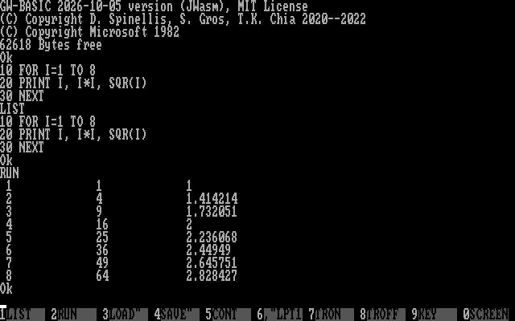
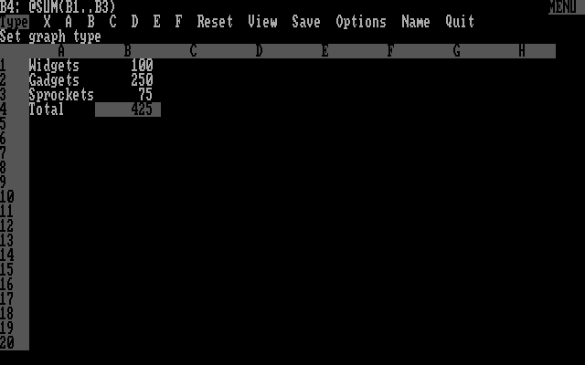
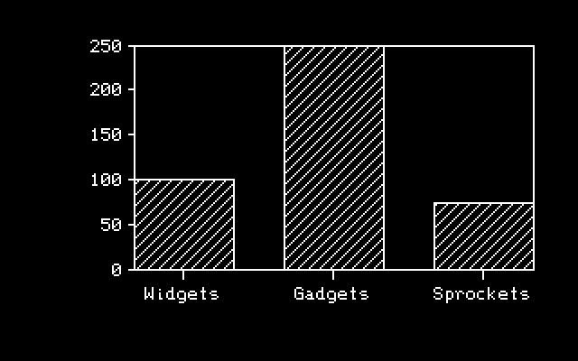
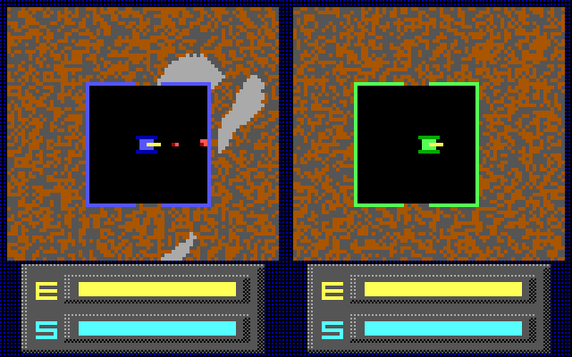
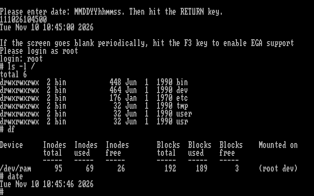
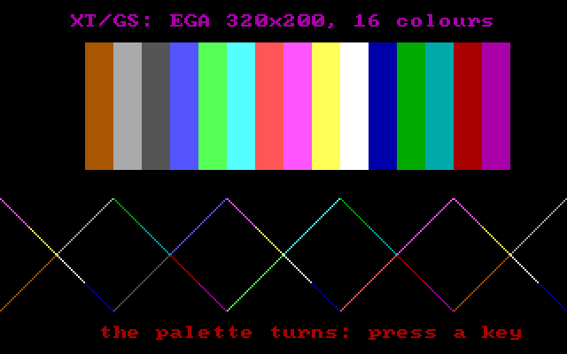
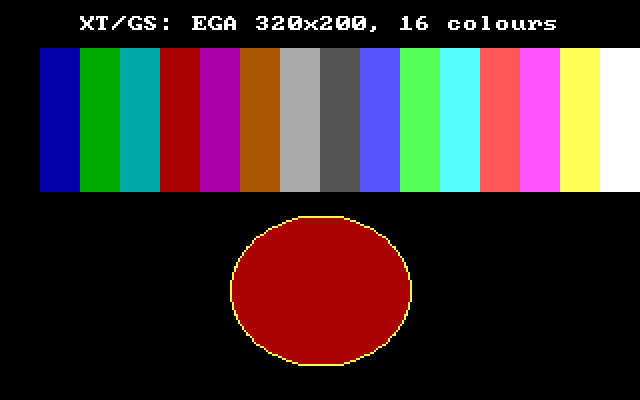
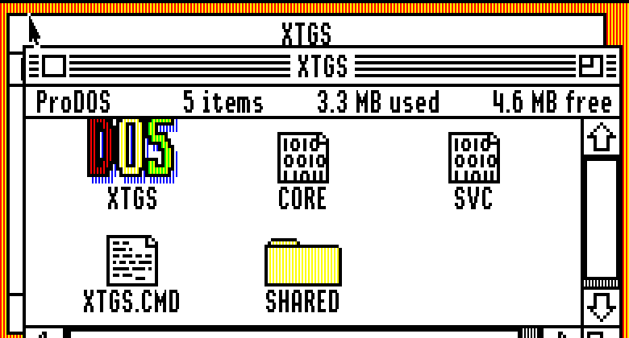
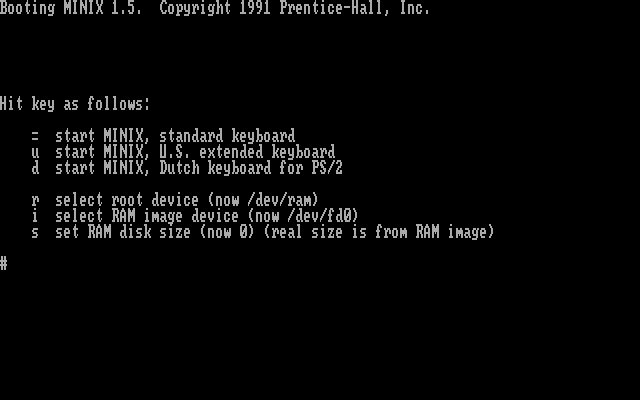

# XT/GS

An IBM PC/XT for the Apple IIGS. XT/GS is an 8086/8088 real-mode interpreter
and a PC-compatible BIOS, written in 65816 assembly (Merlin32) for an 8 MB
Apple IIGS and booted straight from ProDOS 8. It boots FreeDOS, from a
folder of the ProDOS volume or from a floppy image, and runs real DOS
software on top of it: GW-BASIC with CGA graphics and sound, and Lotus 1-2-3
Release 1A. It has the EGA's 320x200 16-colour mode as well, and can be a
Tandy 1000 with that machine's own graphics modes and three-voice sound. It also boots Minix 1.5
from its demonstration diskette, which
drives the PC's interrupt controller, diskette controller and 6845 itself.


| | |
| --- | --- |
|  |  |
| FreeDOS booted from a ProDOS folder: the kernel, FreeCOM and `DIR /W` of drive `C:` | GW-BASIC: three lines typed in, `LIST` from F1, `RUN` from F2 |
|  |  |
| GW-BASIC `SCREEN 1` (CGA 320x200, four colours): `LINE`, `CIRCLE`, `COLOR 1,1` | Lotus 1-2-3 1A: labels, values and `@SUM(B1..B3)` |
|  |  |
| 1-2-3's `/Graph` menu | `/Graph View`: the bar graph of that worksheet, drawn by 1-2-3's CGA driver |
|  |  |
| Tunneler: CGA's 160x100 16-colour mode, the blue tank firing with Control held | Minix 1.5 from its demonstration diskette: the date, the login, `ls -l /`, `df` and `date` |
|  |  |
| `EGADEMO.COM`: EGA mode 0Dh (320x200, 16 colours) drawn through the card's registers, the palette mid-turn | Microsoft GW-BASIC 3.23, `SCREEN 7`: `LINE`, `CIRCLE` and `PAINT` in `EGADEMO.BAS` |
|  |  |
| `TDYDEMO.COM` as a Tandy 1000 (`VIDEO=TANDY`): mode 09h (320x200, 16 colours), drawn on pages 4 and 5 through the page register | The same program's other picture, on pages 6 and 7: it shows the two pairs in turn and turns the palette |

The screenshots are the emulated IIGS's Super Hi-Res screen, captured from
headless MAME runs and doubled in height (the SHR screen is 640x200 or
320x200).

## Status

XT/GS is developed and tested in MAME's `apple2gs` driver (ROM 03, 8 MB), and
it has been **verified to run properly on a real IIGS accelerated to 8 MHz**.
The screenshots, test results and speed figures in this file are from MAME.
It is slow: a stock 2.8 MHz IIGS runs the guest at 22,700 to 28,200
instructions a second on arithmetic code, roughly 1/12 of a 4.77 MHz XT, and
a 16 MHz ZipGS at 126,600 to 158,100 (about half an XT). FreeDOS,
booted from a ProDOS folder, takes 73 seconds of emulated time to
reach its prompt on a stock machine. A ProDOS folder is drive `C:`, and what DOS writes there
are ProDOS files that stay; writes to a floppy image stay in memory and are
lost at power-off. See [Known limits](#known-limits).

## What it does

- **CPU:** the complete 8086/8088 instruction set in real mode, including the
  undocumented behaviour the SingleStepTests 8088 hardware vectors pin down
  (`docs/cpu-compatibility.md`).
- **Memory:** the PC's full 1 MiB, 640 KB of it conventional RAM.
- **Text video:** 80x25 on the IIGS's 640x200 SHR screen with an 8x8 CP437
  font. Colours become four grey levels; there is no colour text.
- **CGA graphics:** modes 4 and 5 (320x200, four colours: both palettes,
  dim and bright, the background colour, and mode 5's cyan, red and
  white), mode 6 (640x200 in black and the colour the program chooses) and
  the 160x100 16-colour mode some games make out of text cells two scan
  lines high.
- **EGA graphics:** mode 0Dh (320x200, 16 colours; GW-BASIC's `SCREEN 7`)
  with the card's four planes, latches, write and read modes, eight pages
  and palette registers. It is the one EGA mode the IIGS screen can show
  pixel for pixel; the 640-wide modes are not there (`docs/ega.md`).
- **Tandy 1000 graphics** (with `VIDEO=TANDY` in `XTGS.CMD`): the page
  register, the video array's palette, mode 09h (320x200, 16 colours,
  four bits a pixel: the SHR's own layout), mode 08h (160x200, 16
  colours) and mode 0Ah (640x200, four colours, in the SHR's 640 mode),
  eight 16K pages to draw on and show. The palette stands
  behind the CGA's modes as well, so a program can have mode 4 in any
  four of the sixteen colours, and the BIOS's text is drawn in the three
  modes (40, 20 and 80 columns), DOS's prompt with it (`docs/tandy.md`).
- **Tandy 1000 sound** (the same line): the SN76496 at port C0h, three
  square-wave voices and the noise, each with its attenuation, played by
  eight more of the DOC's oscillators beside the speaker; the white noise
  is the chip's own shift-register sequence (`docs/sound.md`).
- **Keyboard:** the IIGS keyboard as a PC keyboard, through `INT 16h`, the
  BIOS data area's buffer, and port 60h with IRQ1 for programs that hook
  `INT 09h`: a key held down stays down for them, and Shift and Control are
  keys of their own. Function keys are Option+digit.
- **Timer and sound:** the Ensoniq DOC is both the 8253's IRQ0 tick (18.2 Hz,
  or whatever rate the guest programs) and the PC speaker (`docs/sound.md`).
- **Clock:** the guest's date and time are the IIGS's own, read from its
  clock (never set by the guest), and the timer ticks DOS could not be given
  are made up from it so its time stays right (`docs/clock.md`).
- **Shared drive:** a folder of the ProDOS volume as a DOS drive in Mode B,
  read and written in place, and the drive FreeDOS boots from
  (`docs/share.md`).
- **Disk:** or one floppy image (320 KB to 1.44 MB), held in RAM and served
  through `INT 13h`, and through the diskette controller's own ports (765
  and 8237) to a system that brings its own driver (`docs/minix.md`).
- **Two ways to run a program:** *Mode B* boots a real DOS, from the shared
  folder or a floppy image, with XT/GS supplying only the BIOS and hardware. *Mode A* runs a
  single `.COM` or `.EXE` from the ProDOS volume under a small built-in DOS
  (`INT 21h` implemented in 65816, reporting DOS 3.30), with no DOS kernel
  to boot.

## Quick start

Tools: `merlin32` 1.1.10, `cadius`, `python3`, `nasm`, Homebrew `mame` for the
headless tests, and [Ample](https://github.com/ksherlock/ample) (its `mame64`
and Apple IIGS ROMs) for interactive runs. Install the Lua bridge plugin once
with `tools/mame/install-plugin.sh`.

```
make              # build/xtgs.po: XTGS.SYSTEM + CORE + SVC
make dos-image    # build/boot/boot.po: the same plus FreeDOS in the folder SHARED
make run-dos      # boot that in Ample's MAME
make tandy-image  # build/boot/tandy.po: that volume as a Tandy 1000 (VIDEO=TANDY)
make run-tandy    # boot that in Ample's MAME: TDYSND and TDYDEMO at the prompt
make release      # build/release/xtgs-1.0.po: the 800K volume to hand out (below)
make test-release # boot copies of it headless, from ProDOS 8 and from GS/OS
```

`make release` builds the volume to hand out, `build/release/xtgs-1.0.po`
(the version is `XTGS_VERSION` in the Makefile): one 800K ProDOS disk, named
`XTGS`, that a IIGS boots from ProDOS 8 straight into FreeDOS, and that also
holds the GS/OS application `XTGS` with its Finder icon beside
`XTGS.SYSTEM`, for a launch from the Finder. Its folder `SHARED` is drive
`C:`: FreeDOS, GW-BASIC, the demos (`HELLO.BAS`, `CGADEMO.BAS`, `MUSIC.BAS`,
`EGADEMO.COM`, `TDYDEMO.COM`, `TDYSND.COM`) and an `AUTOEXEC.BAT` that lists
them; `READ.ME` on the disk says how to start it and what `XTGS.CMD`'s lines
are. 474K of the disk is free for what DOS writes (`VOLSIZE=4096KB make
release` for a larger volume). What goes on it beyond the build's own files
is in `release/`.

`make dos-image` downloads the FreeDOS kernel and FreeCOM into `third_party/`
and puts them in a folder `SHARED` of the volume (named `XTGS`), which
FreeDOS boots from as drive `C:`. There is no disk image: the kernel, the
shell and whatever DOS writes are ordinary ProDOS files in that folder, so
files go in and out with any ProDOS tool. GW-BASIC is not downloaded: put a
`GWBASIC.EXE` (the rebuild from gitlab.com/tkchia/GW-BASIC is the one that
works) at `third_party/gwbasic/GWBASIC.EXE` and it goes in the folder too,
with `HELLO.BAS`, `CGADEMO.BAS`, the Tandy modes' `TDYDEMO.COM` (`TDYDEMO 8` for mode 08h, `TDYDEMO A` for 0Ah), the Tandy sound's `TDYSND.COM` (a round for its three voices) and the EGA
mode's `EGADEMO.COM` (and
`EGADEMO.BAS`, which needs a GW-BASIC that has `SCREEN 7`: Microsoft's 3.2x
does, that rebuild of the 1983 source does not). The `.po` is an ordinary 4 MB ProDOS
volume that boots to XT/GS, so it also serves a real IIGS from a
hard-disk-class device.

XT/GS can be launched from GS/OS as well, two ways. Copy `XTGS.SYSTEM`,
`CORE`, `SVC`, `XTGS.CMD` and the folder `SHARED` from that volume into one
folder on a GS/OS disk and open `XTGS.SYSTEM`: GS/OS shuts down into ProDOS 8 to run it
and comes back when XT/GS quits. Or put the native application in that folder
instead of `XTGS.SYSTEM` - `build/xtgs16`, as a file `XTGS` of type S16
(`$B3`) - and open that: it runs the same `CORE` and `SVC` without leaving
GS/OS. `make finder` builds a volume named `XTGS` that boots to the Finder
with that folder on it, `SHARED` with FreeDOS and GW-BASIC inside it
(`build/xtgs-finder.po`; it needs a System 6 volume, `SYSTEM6=path`, and
the `GWBASIC.EXE` above). `XTGS` has its own icon there (`icon/`), and
opening it boots FreeDOS; copy the folder from there with the Finder and
the icon comes along. There is no way back to the Finder from FreeDOS
short of restarting. `XTGS_FRONT=s16 make` builds the test volume
instead, which starts XT/GS with no Finder (`build/xtgs-s16.po`). Both
ways were tested in MAME under System 6.0.1 - `XTGS.SYSTEM` launched by a
startup program, `XTGS` by that and from the Finder - and neither on a
real IIGS yet; `docs/relocation.md`.



Booting FreeDOS takes a minute and a half of emulated time on a stock machine
(MAME's throttle can be turned off to shorten the wait). The folder has no `AUTOEXEC.BAT`, so FreeCOM
asks for the date and the time first, showing the IIGS's: press Return twice
to keep them. Then:

```
C:\>GWBASIC
```

### Booting a floppy image

No commercial software is included. To boot a disk of your own (or
anything that is not FreeDOS, or needs a drive `A:`), put a raw sector
image (320 KB, 360 KB, 720 KB, 1.2 MB or 1.44 MB; the geometry goes by its
size) on the volume as `DISK`, with an `XTGS.CMD` that says `D`. The whole
image is read into memory before the PC starts, and takes 23 banks
(1.44 MB) of the IIGS's memory whatever its size; `make boot-dos` boots
FreeDOS that way, from `third_party/freedos/fd/freedos.img`.

```
make disk-image IMG=mydisk.img    # build/disk/disk.po
make run-disk IMG=mydisk.img      # the same, and boot it in Ample's MAME
```

or by hand:

```
mkdir -p build/my
cp mydisk.img 'build/my/DISK#060000'
printf 'D\r' > 'build/my/XTGS.CMD#040000'
VOLSIZE=4096KB tools/make_image.sh build/my/my.po \
    'build/stage/XTGS.SYSTEM#FF2000' 'build/stage/CORE#060000' \
    'build/stage/SVC#060000' 'build/my/DISK#060000' 'build/my/XTGS.CMD#040000'
tools/mame/run-mame.sh build/my/my.po
```

### Minix

The tree carries one system that is not a DOS: the 360K demonstration
diskette of Minix 1.5 (`third_party/minix/`, under Minix's BSD-style
licence).

```
make run-minix      # build/disk/disk.po with the diskette on it, in Ample's MAME
make minix-image    # only build the volume
```

| | |
| --- | --- |
|  |  |
| The boot menu: press `=` | The date typed, `login: root`, then `ls -l /`, `df` and `date` |

At the boot menu press `=`. Minix loads its root file system from the
diskette into a RAM disk, then asks for the date: twelve digits,
`MMDDYYhhmmss`, and Return (Minix does not read a PC's clock, so it cannot
have the IIGS's). Log in as `root`; there is no password. The diskette has
`sh` and 25 commands in `/bin`, among them `ls`, `cp`, `df`, `date`,
`head`, `tail`, `sort`, `mkfs` and the editor `mined` (no `cat`: `head` or
`tail` will do). There is no shutdown command on it: switch off when done,
nothing is written back.

It is a patient system on this machine. Emulated seconds from power-on, in
MAME:

| | boot menu | date prompt | `login:` | first `#` |
| --- | --- | --- | --- | --- |
| stock IIGS, 2.8 MHz | 18 | 182 | 244 | 264 |
| ZipGS, 16 MHz | 4 | 24 | 32 | 35 |

Minix is the guest that takes the PC at its word. Once its kernel is up it
never calls the BIOS: it moves the 8259's interrupt vectors and masks its
lines, reads the diskette with its own driver through the 765 controller
and the 8237, writes the screen memory and scrolls by the 6845's start
address, and keeps time from a 60 Hz timer interrupt. XT/GS grew each of
those for it (`src/svc/ports.s`, the text renderer in `src/svc/video.s`),
and any other system that drives the hardware gets them too.
`docs/minix.md` has the details, the test (`make test-minix`) and the
limits. Minix has been run in MAME only, not yet on a real IIGS.

### The ProDOS folder that is drive C:

A second line in `XTGS.CMD` names the folder of the ProDOS volume that is a
drive of DOS: its files are read and written in place, so this is how files
get into and out of the PC, and they are still there after the run.

```
S
C=/HARD1/DOSFILES
```

The rest of the line is a ProDOS pathname: a full one, or one below the
folder XT/GS was started from (`C=SHARED`, which is also what `S` alone
means). The folder has to exist. The sign-on screen says
`Drive C: is /HARD1/DOSFILES` when it was found. DOS sees the files whose
ProDOS names are also DOS names (8.3) and can create only names ProDOS
accepts (a letter first, then letters, digits and dots).

Under `S` FreeDOS boots from that folder, which has to hold its
`KERNEL.SYS` and `COMMAND.COM` (`third_party/freedos/fd/SHARED` after
`make dos-image` is one to copy). Under `D` DOS boots from the floppy image
and the folder is one more drive, with the letter the line gives (`C` to
`Z`). `docs/share.md` has the details and the limits.

### The command file

`XTGS.SYSTEM` reads the first line of `XTGS.CMD` and does what it says:

| Command | What it does |
| --- | --- |
| `S` | Mode B: boot FreeDOS from the shared folder (`SHARED` unless a later line names another) |
| `D` | Mode B: boot the floppy image in the file `DISK` |
| `C NAME args` | Mode A: run the `.COM`/`.EXE` file `NAME` under the built-in DOS (`docs/dos-api.md`) |
| `P` | memory probe and an 80x25 test screen |
| `V` | run the CPU test vectors in the file `VEC` |
| `B` | run the benchmark program in `BENCH` until it halts |
| `J`, `K` | the JIT experiments (`docs/jit.md`) |

A later line is a setting for commands `S` and `D`: `letter=pathname` is
the shared drive, above, and `VIDEO=CGA` makes the PC one with no EGA, for
a program that would pick an EGA mode XT/GS does not have (`docs/ega.md`).
`VIDEO=TANDY` makes it a Tandy 1000 (no EGA either; `docs/tandy.md`), and
that line command `C` reads too.

## Keyboard and function keys

The IIGS keyboard has no function keys, so they are chords with **Option**:

| PC key | IIGS key |
| --- | --- |
| F1 ... F9 | Option+1 ... Option+9 |
| F10 | Option+0 |
| Home / End | Option+Left / Option+Right |
| PgUp / PgDn | Option+Up / Option+Down |
| Backspace | Delete |
| Del | Option+Delete |
| Ins | Control+Delete |
| Arrows, Enter, Esc, Tab | arrows, Return, Esc, Tab |
| Ctrl+letter | Control+letter |
| Alt (as a shift state) | Option |

In MAME on a Mac, the IIGS Option key is the **right** Option key (the left
one is Open-Apple) and the IIGS Delete key is the host's Backspace/Delete key.

Two that have been checked end to end:

- **GW-BASIC:** Option+1 types `LIST`, Option+2 runs the program (F1 and F2 on
  the key line at the bottom of the screen); the others follow that line.
- **Lotus 1-2-3:** Option+1 is Help, Option+2 Edit, Option+5 GoTo, Option+9
  Calc, Option+0 Graph. Edit and GoTo were verified.

A program that reads the keyboard itself (port 60h, as games do) sees a key
go down and stay down until it is released, and sees Shift and Control as
keys, alone or with another key. The IIGS reports only its latest key,
though, so one ordinary key is down at a time: pressing a second releases
the first, and releasing either one releases both. A game gets one direction
plus Shift or Control, not a diagonal. This has been tried in MAME only.

Not there yet: Shift, Ctrl or Alt with a function key (WordPerfect's command
set), Alt+letter codes, the numeric keypad as a keypad, and two ordinary keys
down together. Control+H reads as Left, because the IIGS left arrow *is*
Control+H. Details in `docs/keyboard.md`.

## Compatibility

What has actually been run. "Mode B" means under FreeDOS (or the title's own
DOS on its floppy image); "Mode A" means under the built-in DOS.

| Title | Mode | Result |
| --- | --- | --- |
| FreeDOS (8086 kernel 2043, FreeCOM 0.85a) | B | **Works.** Boots to `C:\>` from a ProDOS folder and to `A:\>` from a floppy image; `DIR`, `VER`, running programs |
| GW-BASIC (tkchia's MIT-licensed rebuild of Microsoft's source) | B | **Works.** Editor, `LIST`/`RUN`/`LOAD`, function keys, `SCREEN 1` and `SCREEN 2` drawing with `PRINT`, `LOCATE` and the key line in them, `COLOR`, `SOUND`/`PLAY`/`BEEP` |
| GW-BASIC 3.23 (Microsoft's binary) | B | Runs a program given on the command line; interactively it refuses with "You can not SHELL to BASIC" on FreeDOS. Use the rebuild |
| Lotus 1-2-3 Release 1A (1983), System disk | B | **Partly.** The disk boots its own PC-DOS and the Lotus Access System menu works. The disk is copy-protected and a sector image cannot satisfy the check, so an unmodified `123.EXE` exits back to the menu. With that check bypassed in a private copy, 1-2-3 runs: worksheet entry, formulas, recalculation, F-keys, and graphs in CGA. The stock `AUTOEXEC.BAT`'s clock utility hangs, and the first keystroke in a new worksheet is dropped |
| Minix 1.5, 360K demonstration diskette (in the tree) | B | **Works, slowly.** Boot menu, kernel, RAM disk loaded through Minix's own diskette driver, date prompt, login as `root`, the shell; `ls -l`, `date`, `df`, `mkfs /dev/fd0` and the scrolling console were tried, in MAME. A stock IIGS takes five and a half minutes to the date prompt and eight to the shell, a 16 MHz ZipGS under a minute (`docs/minix.md`) |
| MS-DOS 2.0 `FIND.EXE`, `DEBUG.COM`, `EDLIN.COM`, `MORE.COM` | A | **Work** |
| FreeDOS 1.3 `TREE.COM`, `DEBUG.COM` | A | **Work** |
| FreeDOS 1.3 `FIND.COM` | A | Exits without output after checking the DOS version |
| MS-DOS 2.0 `SORT.EXE` | A | Fails: prints memory garbage and never finishes |
| Tunneler (1991, CGA game) | B | **Runs, far too slowly to play.** Title and menu work; F1 starts a game, "(creating world)" takes a minute or three more at stock speed, and the game then draws in CGA's 160x100 16-colour mode. The tanks turn, move and fire while a key is held (tried in MAME), but at stock speed a tank crosses about three pixels in eight seconds. One direction key at a time: no diagonals, and two players cannot both hold a key |
| WordPerfect | | Untried; it needs the function-key chords that are not mapped yet |

`docs/compatibility-matrix.md` has the Mode A programs in detail and
`docs/mode-b.md` the Mode B ones.

## How it works

Three pieces are loaded from the ProDOS volume:

- **`XTGS.SYSTEM`** (`src/sys/`), the ProDOS 8 loader. It claims memory from
  the Memory Manager, reads `XTGS.CMD`, loads the other two pieces (and the
  disk image, for command `D`), and starts the core. **`XTGS`** (`src/gs/`) is the same thing
  as a native GS/OS application.
- **`CORE`** (`src/core/`, bank `$03`), the CPU.
- **`SVC`** (`src/svc/`, bank `$04`), the PC around it: video, BIOS, the
  built-in DOS, disk, keyboard, timer and sound.

The bank numbers here and below are the ones the code is assembled for. The
loader takes each region wherever the Memory Manager has room and fixes the
bank bytes of `CORE` and `SVC` to match (`docs/relocation.md`), so
`XTGS.SYSTEM` can also be launched from GS/OS, where those banks are taken:
keep `CORE`, `SVC`, `XTGS.CMD` and the folder `SHARED` (or the disk image)
in the same folder. The
bank-`$00` addresses the two use (the direct page, the mailbox, the file
buffers) are relocated the same way, and they reach files only through one
entry the loader provides, so nothing in them is tied to ProDOS 8. The GS/OS
application is a second loader for the same two files: it takes its memory
from the Memory Manager, bank `$00` included, and answers their file calls
with GS/OS calls.

**The interpreter.** The guest's registers and flags live in a direct page;
the 65816's Y register is the guest's IP. Fetching an instruction is six
instructions:

```
fetch   lda [bCS],y        ; opcode byte through the cached CS base pointer
        iny
        and #$00FF
        asl
        tax
        jmp (optab,x)      ; one handler an opcode
```

The opcode table, the ModR/M decode tables and the ALU, `MOV`, `TEST`, `PUSH`
and `POP` handlers are generated (`tools/gen_cpu.py`). Each segment register
keeps a ready-made 24-bit host pointer to its base, recomputed only when the
segment is loaded. The guest's megabyte is sixteen consecutive banks,
`$20`-`$2F`, so wrapping an address to 20 bits is an `AND` and an `ORA`, done
only when an offset carries out of its bank, and `B800:0000` is simply
`$2B:8000`.

Flags are lazy. An arithmetic instruction does not build the 8086's FLAGS; it
saves the 65816's own status byte, its result and its two operands, which is
a `PHP` and four stores. A conditional jump tests the saved status byte
directly (the 65816's N, V, Z and C are the 8086's SF, OF, ZF and CF after
the same operation), and the whole word is assembled only when something
reads it: `PUSHF`, an interrupt, `LAHF`.

The common instructions with a ModR/M byte decode it themselves. A
register-to-register form jumps through a table of its own to a routine that
has both operands as direct-page addresses; a memory form calls one of 48
effective-address routines, one for each addressing mode and operand size,
with the default segment built in.

The string instructions work on host pointers. One alone adds its offset to
the segment's base once; under `REP`, `MOVS` is the 65816's block move
(`MVN`, or `MVP` with the direction flag set), `STOS` a block move that
overlaps itself, and `SCASB` and `CMPSB` short loops, each in runs that end
where an offset or a host pointer would wrap. A long `REP MOVSW` is 23 times
faster than a loop of single moves.

**The BIOS.** Interrupt vectors point at small stubs in segment `F000`, each
an undefined opcode that the core treats as a call into the 65816 service
code, followed by `IRET`. Because the vectors are real, guest programs can
hook and chain them the usual way.

**Video.** Programs write the text buffer or the CGA bitmap directly. Any
store that lands in the bank holding `B800` marks its 256-byte page dirty;
once a frame the dirty parts are redrawn onto the SHR screen. In text mode a
shadow copy means only the character cells that changed are redrawn; in
graphics modes only the changed scanlines are converted, and in the 160x100
mode only the changed cells (`docs/cga.md`). The EGA's planes are not plain
memory: in mode 0Dh an operand in segment `A000` is caught where its address
is formed and read or written through the card's latches and masks, and the
bytes that changed are redrawn (`docs/ega.md`). A Tandy's page register is
answered by moving 16K pages in and out of `B800-BFFF`, so the CPU's
addresses never change; its mode 09h goes to the screen a line a block
move, its mode 08h a byte through a table to two, and its mode 0Ah two
bytes, a bit of each pixel in each, woven into a word (`docs/tandy.md`).

**Interrupts.** The core checks for work at every fourth control transfer (a
taken jump, a call, a return, a `REP` string instruction), so straight-line
code pays nothing for it and no loop escapes it: a timer
tick owed becomes `INT 08h`, a waiting scancode becomes `INT 09h` (both only
while the guest has interrupts enabled; `IRET`, `POPF` and `STI` bring the
check forward when one is owed), and on each vertical blank it polls the
keyboard and flushes the screen.

**Timer and sound.** The 8253 is modelled on the Ensoniq DOC. One oscillator
runs silently and interrupts at the rate the guest programmed into timer
channel 0; that interrupt is the PC's IRQ0. Two more play a square wave at the
channel 2 frequency when the guest opens the speaker gate at port 61h.
As a Tandy 1000 the DOC runs eleven oscillators: a pair for each of the
sound chip's three tones and for its noise, started together so that the
two sides stay in phase, the noise a 32K table of the chip's 15-bit shift
register played at the chip's shift rate (`docs/sound.md`).

**Clock.** The date and time come from the IIGS's clock through the Misc
Tools (`INT 1Ah`, and the built-in DOS's date and time calls). The BIOS tick
count starts at the time of day, and every two seconds it is compared with
the clock: ticks lost while a slow BIOS call ran are added back, so a DOS
that keeps time by counting ticks stays within a second of the IIGS
(`docs/clock.md`).

A runtime translator (8086 blocks to 65816 code) was built and measured as
well. It did not pay for itself on the DOS boot and is not used
(`docs/jit.md`).

## Testing and speed

```
make test-m0      memory probe and test screen
make test-com     nasm .COM programs against expected console output (and
                  the screen: text, CGA, EGA and Tandy pictures against the SHR)
make test-cpu OP="00 01"
                  SingleStepTests 8088 vectors for those opcodes
make test-dos     the Mode A programs in the compatibility table (exits non-zero:
                  the two known failures are part of the set)
make boot-dos     boot FreeDOS from the floppy image headless and report the
                  screen; make boot-shared the same from the folder SHARED
make test-share   a ProDOS folder as drive C: under FreeDOS: DIR, COPY both
                  ways, MD/REN/DEL, programs and GW-BASIC run from it, and
                  the volume compared afterwards (LETTER=E, FULL=1 vary it;
                  BOOT=1: FreeDOS booted from that folder, no disk image)
make test-minix   boot the Minix 1.5 demonstration diskette
                  (third_party/minix/demo_dsk.ibm) to its shell, type a
                  command line and judge the screen (ZIP=1: at 16 MHz, 53
                  emulated seconds instead of 378; CGA=1: as a PC with no
                  EGA, which Minix scrolls another way)
make test-psg     the Tandy's sound chip in MAME's recording: fourteen sounds'
                  frequencies, levels and timing, the noise bit for bit
make test-layout  the probe, .COM and sampled CPU tests with every part of
                  XT/GS in a different bank, and every bank-$00 page it uses
                  at a different address, than it was assembled for
make test-gsos    launch XTGS.SYSTEM from GS/OS (needs a System 6 volume:
                  SYSTEM6=path)
make test-s16     the probe, .COM and sampled CPU tests under the GS/OS
                  application, and launching it three times in one boot;
                  XTGS_FRONT=s16 runs any other test that way
make bench        guest instructions a second, stock and 16 MHz Zip
make lint         assemble everything and check register widths
```

All of these drive headless MAME and judge the result from the emulated
machine's memory. The CPU was validated against the SingleStepTests 8088
suite: all 324 opcode files, 2,883,807 vectors after the exclusions listed in
`tests/cpu/EXCLUDE.md`.

| Benchmark (`docs/benchmarks.md`) | Stock 2.8 MHz | ZipGS 16 MHz |
| --- | ---: | ---: |
| register arithmetic loop | 28,200 IPS | 158,100 IPS |
| memory-operand loop | 22,700 IPS | 126,600 IPS |
| test-and-branch loop | 33,900 IPS | 189,500 IPS |
| short string instructions, a `REP` counted as one | 15,600 IPS | 87,400 IPS |
| `rep movsw` of 16 KB, a word counted as one | 197,000-218,000 IPS | |
| FreeDOS from a folder, to FreeCOM's date prompt | 73 s | |
| FreeDOS from a floppy image, the same | 114 s | |

## Known limits

- Speed, as above. What is left is spread thin: in a FreeDOS boot, fetching
  the opcode is a seventh of the time, ProDOS and the firmware an eighth,
  and no handler has as much as a twentieth (`docs/benchmarks.md`).
- Writes to a floppy image are kept in RAM and never written back to the
  ProDOS volume. Files that should last go on the shared drive.
- The shared drive shows only files with DOS-shaped names, keeps ProDOS's
  dates, and has been run under FreeDOS only, in MAME (`docs/share.md`).
- Booting from the shared folder is for FreeDOS's kernel only and has been
  run in MAME only. The PC has no floppy drive then: `A:` is "not ready".
- Text is monochrome (four greys). There is no MDA, Hercules or VGA, and of
  the EGA only mode 0Dh, set through `INT 10h`: no 640-wide or 350-line
  modes, no loadable fonts, and a store to the planes costs about three
  times an ordinary one. Run in MAME only (`docs/ega.md` has the limits).
- The Tandy 1000 is modes 08h, 09h and 0Ah, the
  pages and the palette (in those modes and behind the CGA's graphics,
  not in 80x25 text), the BIOS's text in the three modes and the sound
  chip (tone periods under 6 are silent, so no sampled sound through
  it; the noise is TI's sequence; `docs/sound.md`), with no
  Tandy keyboard. No Tandy program has been run on it, mode 0Ah
  is built from two emulators' reading of the machine, which differ in
  places, and what the BIOS's text does with colours there is decided
  here and not read from a Tandy's BIOS; run in MAME only
  (`docs/tandy.md`).
- In CGA graphics modes the BIOS draws text from its own 8x8 font
  (`docs/cga.md`): there is no cursor, characters 01h-1Fh (the arrows on
  GW-BASIC's key line among them) are blank, as they are in text mode, and
  a program's own font for characters 80h-FFh (`INT 1Fh`) is not used.
- One ordinary key can be held at a time (plus Shift and Control), and
  several key combinations are missing (above).
- The interrupt controller is its vector base and its mask: no priorities,
  no in-service register, and only the timer, the keyboard and the diskette
  interrupt. There is no A20 or extended memory, and `INT 15h` is nearly
  empty.
- The diskette controller answers at once and has one drive; there is no
  hard disk, serial port or printer port. Minix and the hardware it drives
  have been run in MAME only, and Minix spends a large part of a stock IIGS's
  time on its 60 Hz clock interrupt (`docs/minix.md`).
- The guest reads the IIGS's clock and cannot set it: `DATE` and `TIME`
  under DOS last until the next boot. Run in MAME only (`docs/clock.md`).
- The timer tick tops out at 583 Hz. GW-BASIC's background music runs its
  timer at 400 Hz and loses about 6 % of the ticks.
- GW-BASIC's `TIMER` function returns 0.

## Documentation

| File | Subject |
| --- | --- |
| `docs/mode-b.md` | booting DOS from a disk image; application notes |
| `docs/share.md` | a ProDOS folder as a DOS drive, and as the drive FreeDOS boots from |
| `docs/minix.md` | Minix 1.5, and the hardware it drives directly: the 8259, the diskette controller, the 6845's start address and cursor |
| `docs/dos-api.md` | the built-in DOS and BIOS services of Mode A |
| `docs/keyboard.md` | the key mapping |
| `docs/cga.md` | CGA graphics |
| `docs/ega.md` | the EGA's mode 0Dh: the planes, the registers, the BIOS, `VIDEO=CGA` |
| `docs/tandy.md` | the Tandy 1000: `VIDEO=TANDY`, the page register, the array, modes 08h, 09h and 0Ah, the sound chip |
| `docs/sound.md` | the DOC as PC speaker and timer, and as the Tandy's three voices and noise |
| `docs/clock.md` | the IIGS's clock as the PC's date, time and tick count |
| `docs/cpu-compatibility.md` | 8088 behaviour learned from the hardware vectors |
| `docs/benchmarks.md` | measurements and where the time goes |
| `docs/jit.md` | the translator experiment |
| `docs/relocation.md` | how the loader places XT/GS in whatever banks and bank-`$00` pages it is given; launching from GS/OS; the native GS/OS application |
| `docs/compatibility-matrix.md` | Mode A program results |
| `BOOTSTRAP.md`, `apple_iigs_xt_emulator_project_plan.md` | toolchain, design and the plan |
| `CLAUDE.md` | layout, memory map and the Merlin32 rules this tree follows |

## Third-party software

Two third-party things are distributed in this tree: the public-domain
`font8x8` glyphs, and the Minix 1.5 demonstration diskette
(`third_party/minix/demo_dsk.ibm`, unmodified), which is under the BSD-style
licence Prentice Hall agreed to for Minix in April 2000
(`third_party/minix/LICENSE`). The build fetches the rest into `third_party/`: the FreeDOS
kernel and utilities (GPL), FreeCOM, Microsoft's MIT-licensed MS-DOS 2.0
binaries, and the SingleStepTests 8088 vectors. GW-BASIC is tkchia's rebuild
of Microsoft's MIT-licensed source. Lotus 1-2-3 and other commercial titles
are not included; supply your own media.

## Acknowledgements

Another fine [cCc] release that would not have happened without the rest of the gang. Plenty more to come in the pipeline.

